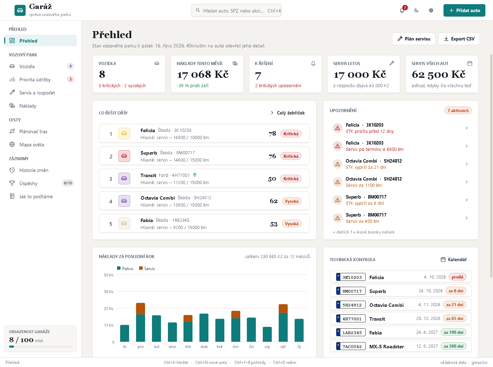

# Garáž – správa vozového parku

Desktopová aplikace v Javě (Swing, bez externích knihoven) pro správu malého vozového parku:
priorita údržby, servis a rozpočet, náklady, STK, plánování tras a historie změn.
Vzhled a principy (vážené skóre, ruční připnutí priority, odhady a simulace, metodika) vycházejí
z projektu [Cesty KHK](https://github.com/drapek9/zddpln-hackaton_khk).



## Co umí

- **Přehled** – souhrnná čísla, „co řešit dřív“, upozornění, náklady za 12 měsíců, blížící se STK, nádrže.
- **Vozidla** – seznam s hledáním, filtrem a řazením; detail auta s akcemi (tankování, výlet, trasa na mapě,
  servis, simulace odstávky, 3D model, úprava, připnutí priority).
- **Priorita údržby** – skóre 0–100 ze šesti faktorů, posuvníky vah, předvolby, živý žebříček,
  ruční připnutí s důvodem a porovnání „Proč A před B“.
- **Servis a rozpočet** – plán servisu do ročního rozpočtu (odhad ceny), kalendář STK, servisní kniha.
- **Náklady** – palivo a servis po měsících, náklady podle aut, cena za km, kniha tankování.
- **Plánovač tras** a **mapa světa**, **historie změn** (audit), **úspěchy**, **metodika**.
- Světlý a tmavý režim, příkazová paleta (Ctrl+K), export do CSV, automatické ukládání.

## Spuštění

Potřeba je JDK 17 nebo novější.

```bash
javac -encoding UTF-8 -d bin $(find src -name '*.java')
java -cp bin gui.MainFrame
```

Ve VS Code stačí spustit třídu `gui.MainFrame`.

Data se ukládají do `~/.garaz/garaz.tsv` (textový soubor UTF-8). Při prvním spuštění se načte
ukázková garáž s osmi auty a rokem tankování.

## Klávesové zkratky

| Zkratka | Akce |
|---|---|
| Ctrl+K | hledání a příkazy |
| Ctrl+N | přidat auto |
| Ctrl+S | uložit |
| Ctrl+D | světlý / tmavý režim |
| Ctrl+1 – 8 | přepnout pohled |

## Struktura

- `src/data` – model (`Auto`, `Garaz`) a ukládání (`Uloziste`)
- `src/gui` – hlavní okno, pohledy, design systém (`Ui`), grafy, dialogy, mapy a 3D model
- `nahled` – snímky obrazovky
